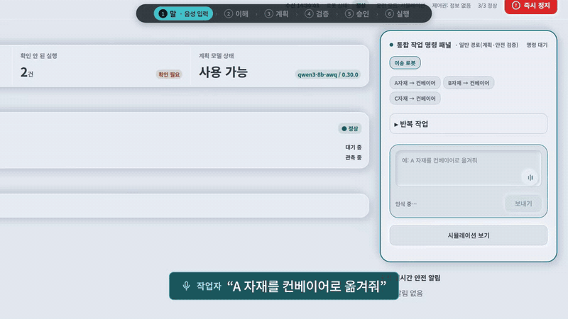
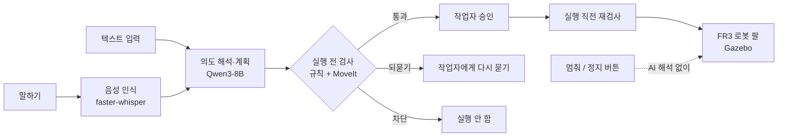

# FORSTICK

**말로 지시하면 AI가 작업 계획을 세우고, 안전 검사와 사람의 승인을 거친 뒤에만 로봇이 움직이는 시스템**

> "1번 팔레트 자재를 컨베이어로 옮겨줘" → 계획 생성 → 안전 검사 → 작업자 승인 → 로봇 팔 실행
> 현재는 실제 로봇이 아닌 **시뮬레이션**(Gazebo, FR3 로봇 팔)에서 동작합니다.

<!-- 시연 GIF 자리: docs/images/demo.gif (90초 시연 영상에서 10~15초 발췌) -->


---

## 왜 만들었나

- 한국은 제조업 로봇 밀도 세계 1위(IFR, 2024)지만, 작업이 바뀌면 전용 장비와 전문지식으로 로봇을 다시 설정해야 합니다(산업연구원, 2026).
- AI(언어모델)에게 바로 맡기면, 잘못 알아들은 지시가 그대로 로봇 동작이 될 수 있습니다.
- 그래서 **AI는 계획만 만들고, 실행 여부는 규칙 기반 검사와 사람이 정하도록** 나눴습니다.

## 핵심 기능

| 기능 | 설명 |
|---|---|
| 음성·텍스트 명령 | 한국어로 말하거나 입력하면 단계별 작업 계획으로 바꿉니다 |
| 실행 전 검사 | 계획마다 **통과 / 되묻기 / 차단** 중 하나로 판정합니다 |
| 사람 승인 | 검사를 통과해도 작업자가 확인 카드에서 승인해야 작업이 만들어집니다 |
| 즉시 정지 | "멈춰"는 AI 해석을 거치지 않고 바로 정지 요청, 정지는 로그인 없이도 받습니다 |
| 관제 대시보드 | 시뮬레이션의 로봇 자세를 받아 3D로 표시, 상태·기록·진단 화면 |
| 기록 | 요청 문장, 음성 인식 결과, 계획, 검사 결과, 승인, 실행 결과를 DB에 남깁니다 |

**되묻기와 차단의 차이**
- 되묻기: 지시가 애매할 때 (대상이나 목적지 후보가 여러 개)
- 차단: 해서는 안 될 때 (등록 안 된 자재, 출발지에 자재 없음, 충돌·도달 불가)

## 동작 흐름



## 기술 스택

| 영역 | 사용 기술 |
|---|---|
| 화면 | React 18, Vite, Three.js (3D 표시), Playwright (자동 점검) |
| 서버 | Python, uvicorn (프레임워크 없이 직접 구성), HTTP + WebSocket(실시간 통신) |
| AI | faster-whisper (음성 인식), Qwen3-8B-AWQ + vLLM (명령 해석) |
| 로봇·시뮬레이션 | ROS 2, Gazebo, MoveIt 2(동작·충돌 검사), FR3 로봇 팔 + Robotiq 2F-85 그리퍼 |
| DB | SQLite (저장 계층을 분리해 PostgreSQL 구현을 추가할 수 있는 구조) |
| 로그인 | Google 로그인, 미리 등록된 계정만 (설정으로 켜고 끔) |

## 결과

시뮬레이션에서 미리 정한 시험 명령 100개(정상 35 · 차단해야 21 · 되묻기해야 32 · 정지 12)로 평가했습니다. 실제 로봇에서의 안전성을 보장하는 결과는 아닙니다.

- 막거나 되묻거나 멈춰야 할 65건 중 **실행으로 통과한 것 0건**
- 정지 명령 12건 **모두 계획 없이 바로 정지**로 처리
- 명령 후 계획이 나오기까지 보통 **2.65초**, 10번 중 9번은 3.8초 안

**아직 부족한 점**: 정상 지시를 잘못 막는 비율이 17.1%(목표 10% 이하)입니다. 예를 들어 로봇에게 특정 위치로 이동만 하라는 지시를, 자재를 옮기라는 지시로 오해해 되묻는 경우가 있습니다.

## 트러블슈팅

**1. 연결이 끊겨도 화면에 '정상'으로 표시됨 (프론트)**
- 원인: 서버에서 값을 받지 못하면 마지막 값을 그대로 보여 줘서, 문제가 없는 것처럼 보였습니다.
- 해결: 연결이 정상이 아닐 때는 '정상'을 표시하지 않도록 바꿨습니다. 기존 기능 재확인 10항목과 새 테스트 8개로 확인했습니다.

**2. 출발지와 목적지가 뒤바뀐 계획이 검사를 통과함 (백엔드)**
- 원인: 계획 안에 지시한 장소가 들어 있는지만 보고, 어디가 출발지고 어디가 목적지인지는 비교하지 않았습니다.
- 해결: 집는 곳은 지시한 출발지와, 놓는 곳은 지시한 목적지와 각각 맞춰 보도록 바꿔서, 뒤바뀐 계획은 실행 전에 막힙니다.

## 팀

| 이름 | 역할 | 주요 작업 |
|---|---|---|
| 손대호 | 팀장 · 프론트엔드 | 작업자 대시보드, 로그인·계정 관리 |
| 김예은 | PM | 일정 관리, 요구사항 정리 |
| 김남수 | 백엔드 · DB | 음성·명령 해석 서버, 로봇 시뮬레이션 구축 |
| 이윤예 | 문서 | 기획서 작성, 회의록 정리 |

## 빠른 실행

대시보드 화면만 띄우는 방법입니다. 실제 동작에는 백엔드 서버(로봇 시뮬레이션, AI 서버)가 함께 떠 있어야 합니다.

```bash
# bash 기준 (Windows PowerShell은 실행 가이드 참고)
cd dashboard2
npm install
FORSTICK2_BACKEND_URL=https://<백엔드 주소>:<포트> npm run dev   # http://localhost:5175
```

시뮬레이션·AI 서버 실행, 경로 설정, 테스트 방법은 **[실행 가이드](docs/실행가이드.md)** 에 정리했습니다.

## 폴더 구조

| 폴더 | 내용 |
|---|---|
| `dashboard2/` | 관제 대시보드 (React) |
| `server/` | API 서버, 로그인 |
| `stt/` | 음성 인식 |
| `planning/` | 명령 해석·계획 생성 |
| `validation/` | 실행 전 검사 |
| `storage/` | 기록 저장 (DB) |
| `config/` | 로봇·작업 셀 설정 |
| `tests/` | 자동 테스트 |
